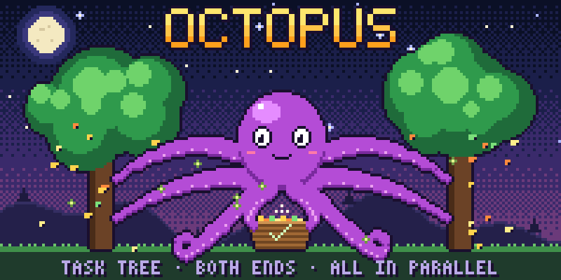

# octopus — скилл для Claude Code

Любая задача — дерево. Осьминог трясёт его и снимает листья **параллельно**, каждую ветку ведёт **с двух концов навстречу**: от причины и от результата. Проверки — тоже листья и идут рядом с кодом, а не после.



## Что внутри

| Файл | Что делает |
|---|---|
| `SKILL.md` | Сам скилл: дерево → ветки → листья → сегменты, пара «строитель + приёмщик» на каждый лист, красный прогон до правки, критик до слияния, статус деревом |
| `peresechenie.py` | Пересечения заданий агентов: один файл в двух заданиях — стоп. С `--graphify` ловит скрытые связи по карте кода; `zadeto` — кого задевает правка; `sverka` — «обещал / сделал» по git |
| `papki.py` | Отдельные рабочие папки (git worktree) для агентов и уборка только слитых и чистых |
| `doska.py` | Доска листьев: `doska/derevo.json` и локальная страница `doska/doska.html` без сети |
| `skhema-*.png` | Рисунки схемы от руки |
| `art/banner.py` | Заставка сверху — нарисована кодом: `python art/banner.py` (нужен Pillow) |
| `test_*.py` | Тесты всех трёх скриптов |

## Установка

```bash
git clone https://github.com/zolozolilo/octopus-skill ~/.claude/skills/octopus
```

Claude Code подхватит скилл сам: он срабатывает на любой многошаговой задаче и на словах «осьминог», «дерево», «параллельно», «с двух концов».

Нужны Python 3 и git. Карта кода [Graphify](https://docs.graphify.com) — по желанию: без неё `peresechenie.py` проверяет пересечения по именам файлов и честно пишет «карта: НЕ ЗНАЮ».

Тесты:

```bash
cd ~/.claude/skills/octopus && python -m pytest -q
```

## English

**octopus** is a Claude Code skill for multi-step work. Every task is a tree; independent leaves run in parallel, and each branch is worked from both ends at once — from the cause and from the delivered result. Every leaf is a builder/acceptor pair: the acceptor writes failing acceptance tests first, and a red run is saved before the fix. An independent critic reviews agent work before merge. Helper scripts check that agent tasks do not touch the same files (optionally via a [Graphify](https://docs.graphify.com) code map), manage agent worktrees, and render a local task board. The skill text is in Russian.

## Лицензия

MIT — см. [LICENSE](LICENSE).
